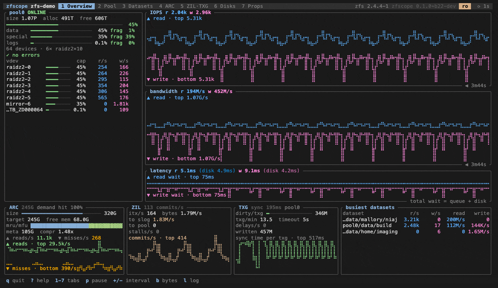
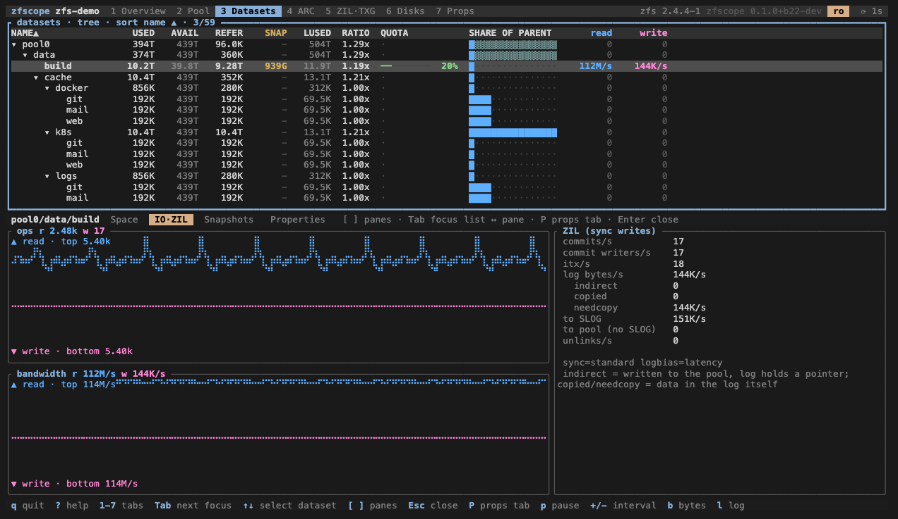
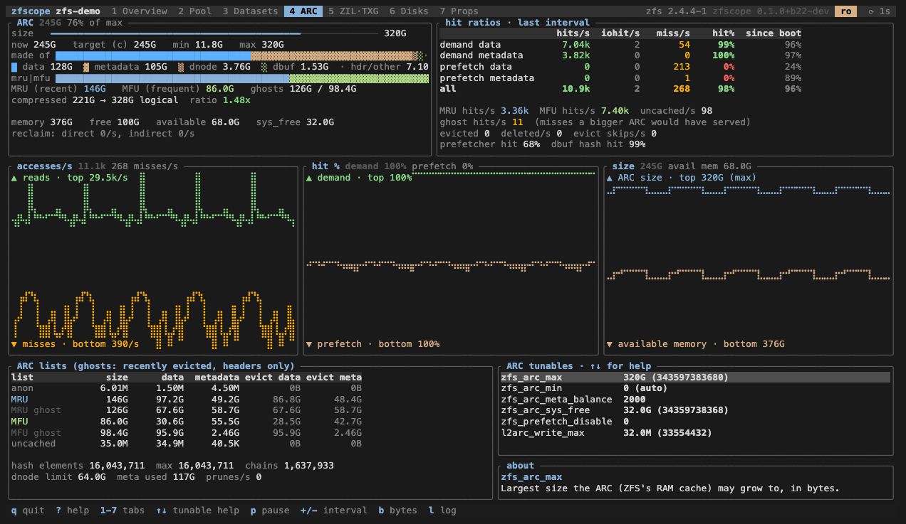
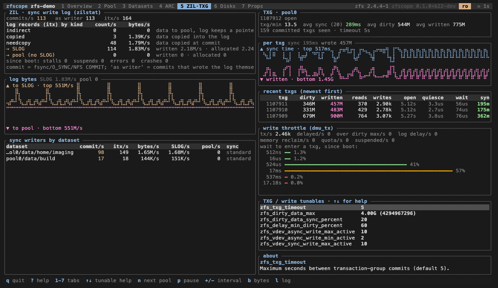
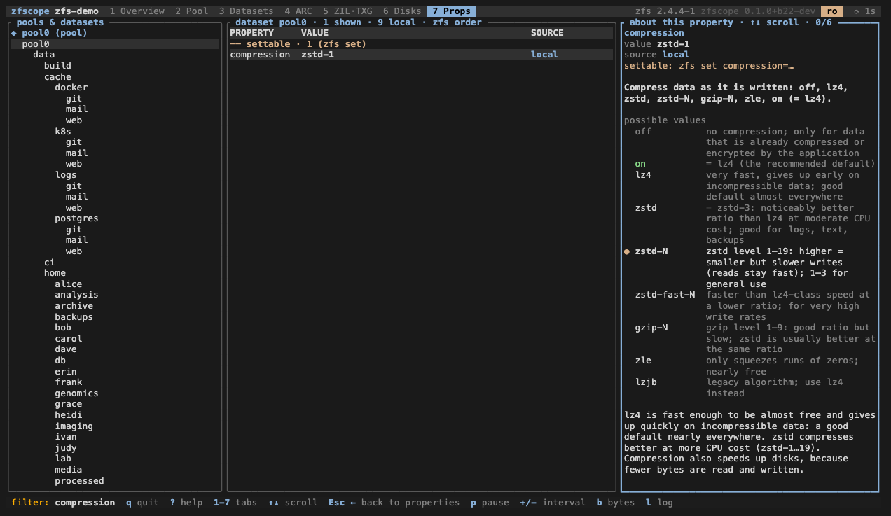

# zfscope

[](https://github.com/dheshanm/zfscope/releases/latest)
[](LICENSE)

`top` for OpenZFS hosts: a live terminal view of what a ZFS server is doing and how it is set up. One static binary,
no dependencies, read-only by default.



## What it shows

| View | |
|---|---|
| **1 Overview** | Pool health and capacity per class, IOPS / bandwidth / latency graphs, ARC, ZIL, TXG, busiest datasets |
| **2 Pool** | vdev/disk tree with live IO, latency, queue and space; per-device graphs, latency heatmap, request-size histogram, a disk grid to spot the one slow disk, `zpool history` |
| **3 Datasets** | Space breakdown (snapshots, children, quotas), per-dataset IO and ZIL, snapshots, properties |
| **4 ARC** | Size and composition, hit ratios per access class, ghost hits, tunables |
| **5 ZIL·TXG** | Sync-write logging per pool and dataset, SLOG vs pool, transaction groups, the write throttle |
| **6 Disks** | Every physical disk behind the pools: enclosure slot, multipath paths, SMART health, temperature, util/await |
| **7 Props** | Every pool and dataset property with its source, possible values and plain-language help; feature flags and module parameters too |

Graphs are mirrored braille lines (reads up, writes down). Press `?` in any view for a guide to what it shows.

| | |
|---|---|
|  Overview |  Pool: topology, graphs, latency heatmap |
|  Disk grid |  Datasets: space, IO, ZIL |
|  ARC |  ZIL and TXGs |
|  Disks: slots, paths, SMART |  Properties with help |

Screenshots come from a sanitised capture of a real 60-disk server, not a mock.

## Requirements

- Linux (x86_64 or aarch64) with **OpenZFS 2.3 or newer**, which added JSON output to `zpool` / `zfs`. Check with
  `zfs version`. Developed against 2.4.
- Root for the `zpool` and `smartctl` data; the kstat-based views (ARC, ZIL, TXG, dataset IO) work as any user.
- `smartctl` (smartmontools) is optional; without it the Disks view shows sysfs data only.

## Install

Download the static binary on the ZFS host:

```sh
curl -fLo /usr/local/sbin/zfscope \
  "https://github.com/dheshanm/zfscope/releases/latest/download/zfscope-$(uname -m)-unknown-linux-musl"
chmod +x /usr/local/sbin/zfscope
```

To verify it, compare against the release's `SHA256SUMS`:

```sh
curl -fsSL https://github.com/dheshanm/zfscope/releases/latest/download/SHA256SUMS | grep "$(uname -m)"
sha256sum /usr/local/sbin/zfscope
```

**Or build it** on any machine with Rust (no Docker or extra linker needed) and copy it over:

```sh
git clone https://github.com/dheshanm/zfscope && cd zfscope
rustup target add x86_64-unknown-linux-musl
cargo build --release --target x86_64-unknown-linux-musl
scp target/x86_64-unknown-linux-musl/release/zfscope root@SERVER:/usr/local/sbin/
```

## Usage

```sh
zfscope                 # live view, sampling every second
zfscope -i 5            # sample every 5 seconds (1-60; +/- change it while running)
zfscope --dump          # print everything it collects once and exit (quick check of a new host)
```

| Option | |
|---|---|
| `-i`, `--interval N` | Sampling interval in seconds, 1-60 (default 1) |
| `--no-smart` | Don't run `smartctl` |
| `--no-mouse` | Don't capture the mouse (keeps the terminal's own text selection) |
| `--read-only` | Never allow write mode, even as root |
| `--log FILE` | Log file (default `/var/log/zfscope.log`, owner-readable only; filter with `RUST_LOG`) |
| `--fixture DIR` | Replay a capture instead of the live system |

| Key | |
|---|---|
| `1`-`7` | Switch view |
| `?` | Help for the current view |
| `↑↓` / `j k`, `Enter` / `Esc` | Move, drill in / out |
| `/` | Filter |
| `s` / `S`, or click a header | Sort / reverse |
| `+` / `-` | Sampling interval |
| `p` | Pause (freezes the screen and frees the mouse for copying text) |
| `l` | Change log pane |
| `W` | Unlock / lock write mode |
| `q` | Quit |

## Write mode

zfscope starts read-only, even as root. As root, press `W` and confirm to unlock write mode for the session (the
header badge turns from `ro` to `rw`; `W` locks it again).

**Properties**, in Props (or Datasets ▸ Properties):

- `e`: set the selected property (`zfs set` / `zpool set`). Known values are listed to pick with `↑↓`. On a
  disabled feature flag, this enables it.
- `i`: reset a locally set dataset property to inherited (`zfs inherit`). On a user property, this removes it.
- `a`: add a `namespace:name` user property.

**Module tunables**, in ARC and ZIL·TXG (e.g. `zfs_arc_max`, `zfs_txg_timeout`):

- `e`: set the selected tunable; `Tab` picks whether it applies **now** (`/sys/module/zfs/parameters`), **now and
  at boot**, or **at boot only** (an `options zfs` line in `/etc/modprobe.d/zfs.conf`).
- `i`: reset it to the default now and remove its boot setting.

Every change shows the exact command or file edit and its effect, then runs only after `y`. Commands run directly,
never through a shell. Enabling a feature flag can't be undone, so it needs the pool name typed instead. Each change
is logged: in the `l` pane, in the log file, and (for properties) by ZFS itself in `zpool history`. With
`--fixture`, write mode is a dry run: changes are shown but never applied.

## Contributing

Issues and pull requests are welcome. Captures from hosts with unusual layouts (dRAID, special vdevs, many
enclosures, other OpenZFS versions) are especially useful for testing.

```sh
cargo test                                        # parsers, collectors and render snapshots of every view
cargo run -- --fixture tests/fixtures/demo        # run against the bundled demo capture, on any OS
```

See [CONTRIBUTING.md](CONTRIBUTING.md) for capturing fixtures from a real host, deploying test builds, the code
layout, and how releases are made.

## License

[Unlicense](LICENSE) (public domain).
