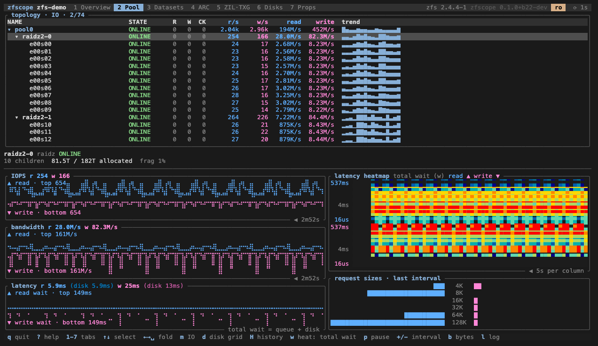
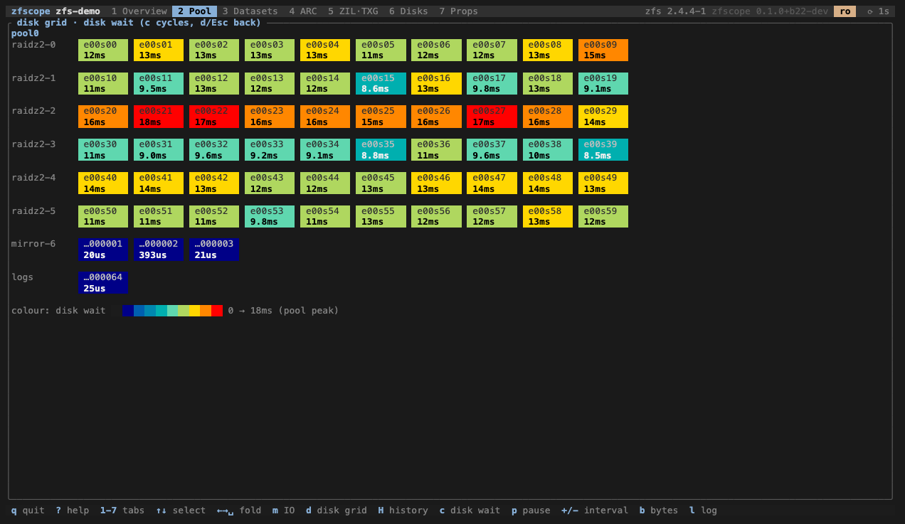
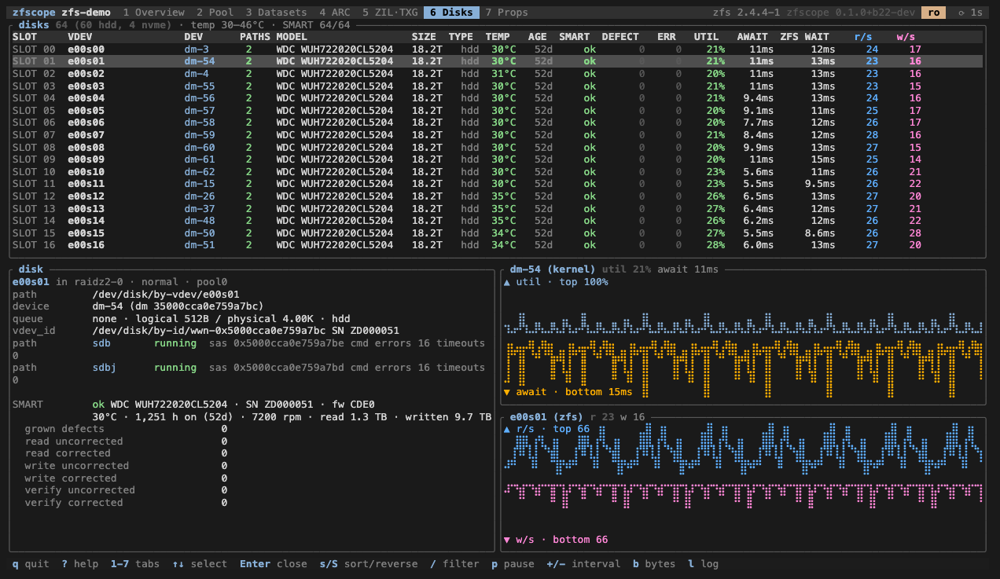

# zfscope

`top` for OpenZFS hosts: a live terminal view of what a ZFS server is doing and how it is set up.


- **Overview**: pool health and capacity per class, IOPS / bandwidth / latency graphs, ARC, ZIL, TXG, busiest datasets
- **Pool**: vdev/disk tree with live IO, latency, queue and space columns; per-device graphs, a latency heatmap,
  request-size histogram, a disk grid to spot the one slow disk, and `zpool history`
- **Datasets**: space breakdown (snapshots, children, quotas), per-dataset IO and ZIL (ztop), snapshots, properties
- **ARC**: size and composition, hit ratios per access class, ghost hits, tunables
- **ZIL·TXG**: sync-write logging per pool and dataset, SLOG vs pool, transaction groups, the write throttle
- **Disks**: every physical disk behind the pool: enclosure slot, multipath paths, SMART health, temperature,
  util/await
- **Props**: every pool and dataset property with its source, possible values and plain-language help, plus help
  for feature flags and module parameters

Graphs are mirrored braille lines (reads up, writes down); press `?` in any view for a guide to what it shows.

| | |
|---|---|
|  Overview |  Pool: topology, graphs, latency heatmap |
|  Disk grid |  Datasets: space, IO, ZIL |
|  ARC |  ZIL and TXGs |
|  Disks: slots, paths, SMART |  Properties with help |

Screenshots come from a sanitised capture of a real 60-disk server (`tests/fixtures/demo`), not a mock.

## Install

Download the static binary on the ZFS host (no dependencies, any distribution):

```sh
# $(uname -m) picks x86_64 or aarch64
curl -fLo /usr/local/sbin/zfscope \
  "https://github.com/dheshanm/zfscope/releases/latest/download/zfscope-$(uname -m)-unknown-linux-musl"
chmod +x /usr/local/sbin/zfscope
```

Each [release](https://github.com/dheshanm/zfscope/releases) lists `SHA256SUMS` for checking the download.

**Or build it** on any machine (no Docker or extra linker needed) and copy it over:

```sh
git clone https://github.com/dheshanm/zfscope && cd zfscope
rustup target add x86_64-unknown-linux-musl
cargo build --release --target x86_64-unknown-linux-musl
scp target/x86_64-unknown-linux-musl/release/zfscope root@SERVER:/usr/local/sbin/
```

## Usage

Run it on the ZFS host. Root is needed for `zpool` / `smartctl`; the kstat-based views work as any user.

```sh
zfscope                 # 1-second sampling (+/- to change)
zfscope --dump          # print everything it collects once, no TUI (quick check of a new host)
zfscope --no-smart      # don't run smartctl
zfscope --fixture DIR   # replay a capture instead of the live system
zfscope --read-only     # never allow write mode, even as root
```

Keys: `1`–`7` views · `?` help · `/` filter · click a header to sort · `Enter`/`Esc` drill in/out ·
`p` pause (freezes the screen and frees the mouse for copying text) · `q` quit.

## Write mode

zfscope starts read-only, even as root. As root, press `W` and confirm to unlock write mode for the session (the
header badge turns from `ro` to `rw`; `W` locks it again). Then, in **Props** (or **Datasets ▸ Properties**):

- `e`: set the selected property (`zfs set` / `zpool set`). Known values are listed to pick with `↑↓`. On a
  disabled feature flag, this enables it.
- `i`: reset a locally set dataset property to inherited (`zfs inherit`). On a user property, this removes it.
- `a`: add a `namespace:name` user property.

Every change shows the exact command and its effect, then runs only after `y`. Enabling a feature flag can't be
undone, so it needs the pool name typed instead. Each change is logged: in the `l` pane, in the log file, and by
ZFS itself in `zpool history`. With `--fixture`, write mode is a dry run: commands are shown but never executed.

## Requirements

Linux with OpenZFS 2.3 or newer (JSON output of `zpool`/`zfs`); developed against 2.4.4.

## Development

```sh
cargo test
scripts/capture-fixture.sh root@host 90          # capture a replayable fixture (names pseudonymised on the host)
cargo run -- --fixture tests/fixtures/local/host  # run against it, on any OS
scripts/deploy-test.sh root@host                  # build and copy to host:/tmp/zfscope-test
```

Captures go to `tests/fixtures/local/` (gitignored): dataset and snapshot names are replaced on the server before
anything is copied, but they are still real host data and are never committed.

Each release build of changed sources gets the next build number (`BUILD`), shown as `0.1.0+bN` in the header;
tagged releases (`ZFSCOPE_RELEASE=1`) are just `0.1.0`.

`scripts/sanitize-fixture.py` turns a capture into a committable fixture (host names, serials, WWNs, GUIDs and IPs
replaced; fails if anything original remains); `scripts/screenshots.sh` regenerates `docs/` from it. Render tests
(`tests/render.rs`) snapshot every view: `cargo insta review` after an intentional UI change.

## License

Unlicense (public domain).
